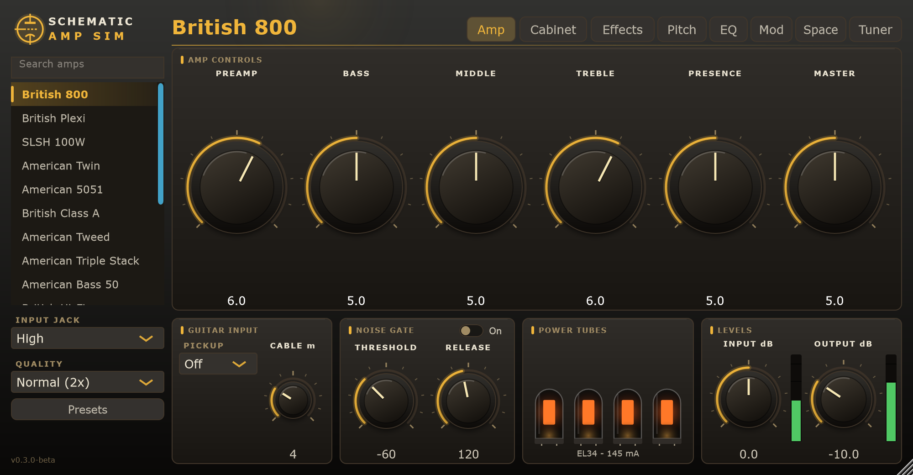
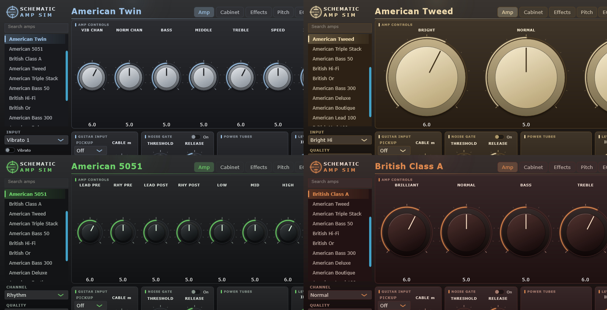
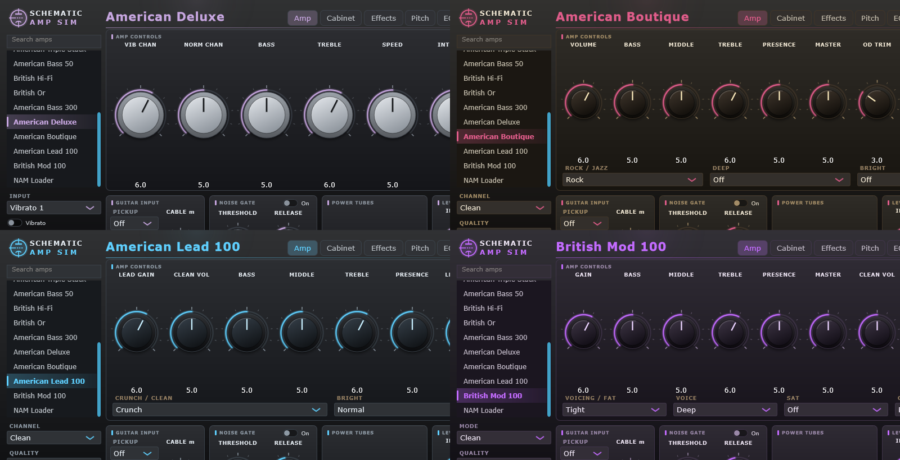
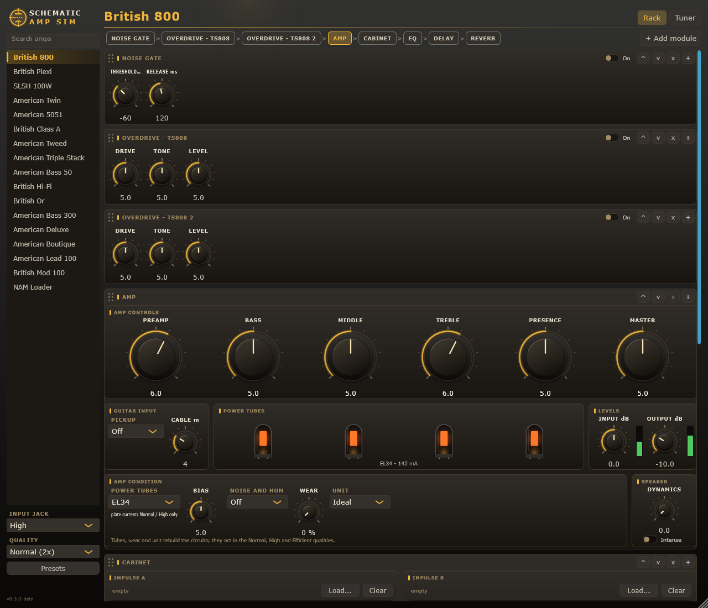
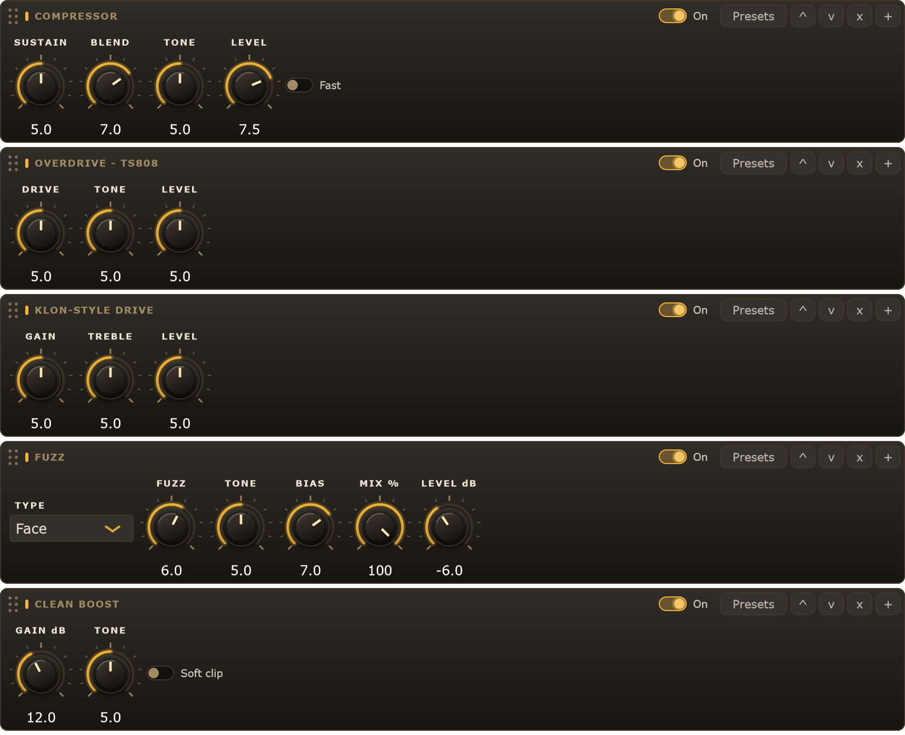
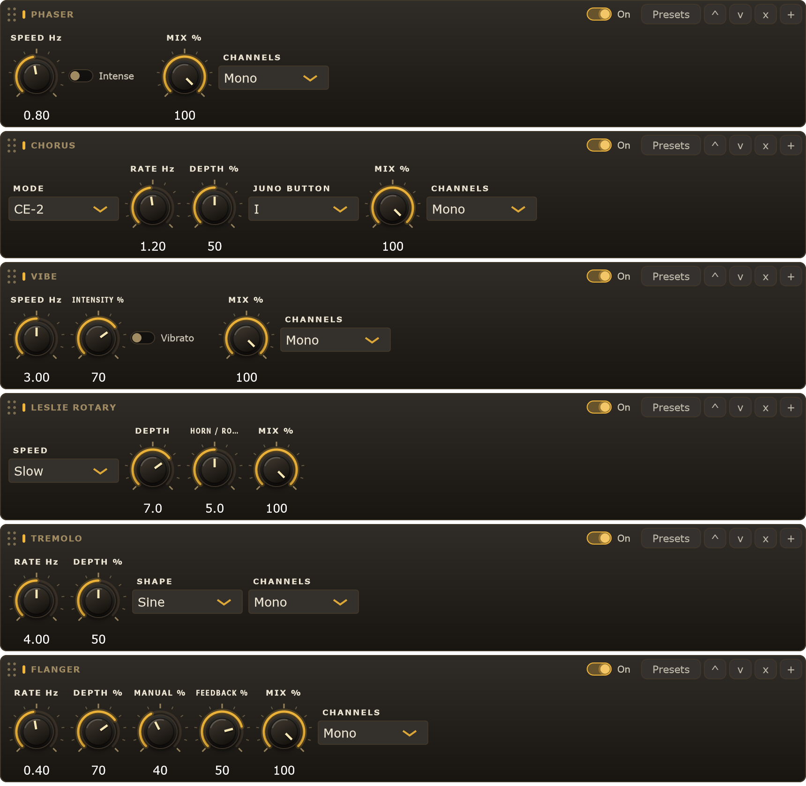
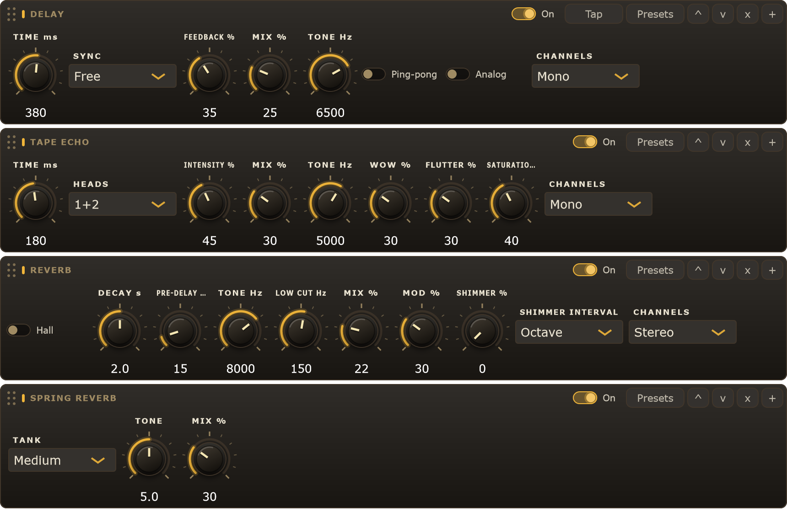
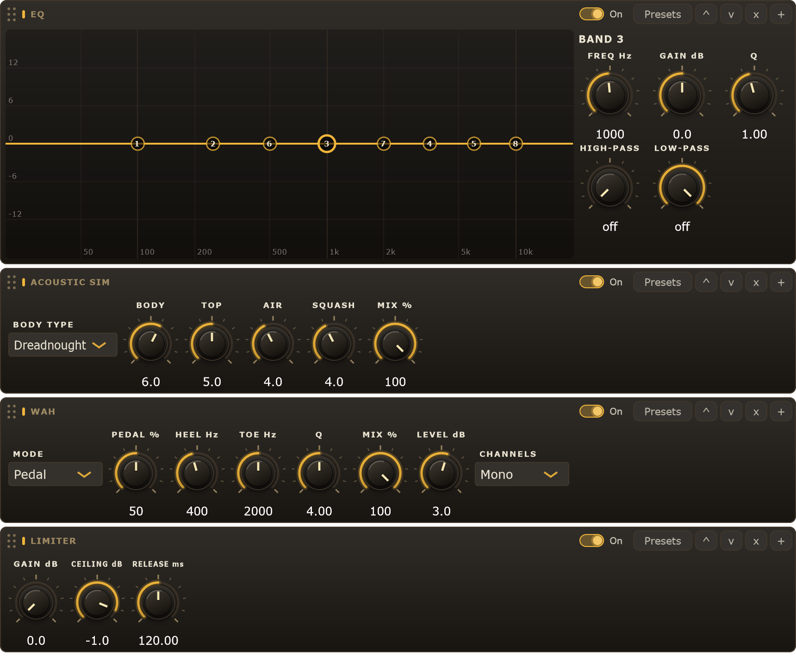
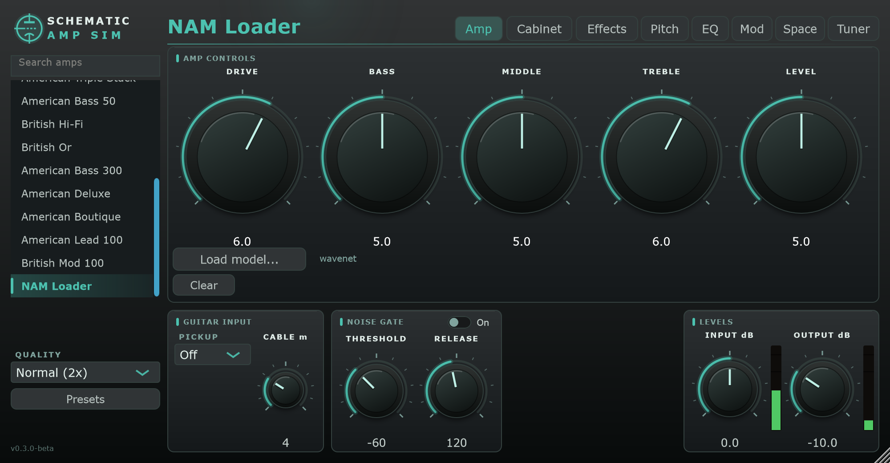
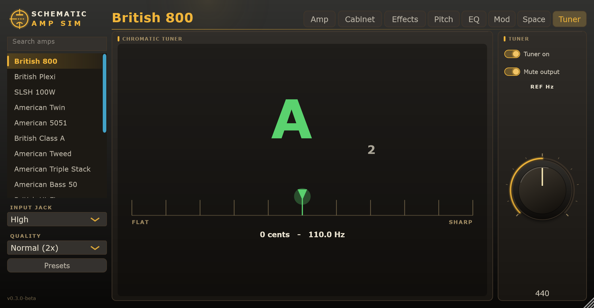

# Schematic Amp Sim

Un simulador de ampli de guitarra que **resuelve el circuito real** en lugar de imitarlo. Cada ampli está transcrito
de su esquemático a una netlist de texto, y el plugin corre en tiempo real un solver de circuitos no lineal sobre ella:
etapas de preamp, tone stack, inversor de fase, tubos de salida y transformador incluidos.

Plugin VST3 y aplicación Standalone para Windows, hechos con C++20 y [JUCE](https://juce.com). También puede correr
modelos neuronales de [Neural Amp Modeler](https://www.neuralampmodeler.com) (ampli, gabinete y pedal).
English version: [README.md](README.md).

<p align="center">
  
</p>

## Capturas

Cada ampli tiene sus propios colores, y la lista de amplis (a la izquierda) está agrupada por carácter: limpios, crunch, alta ganancia y bajo. Cuatro de los veintitrés amplis de circuito y, después, los cuatro más nuevos (el American 5153, el American Clean 120, el American Triple Stack y el American Bass 300):

<p align="center">
  <br>
  
</p>

El **Rack**: todos los módulos en orden de señal, con un **+** para agregar más; el panel del módulo elegido se abre debajo (aquí el ampli, con su condición: válvulas, bias, ruido, desgaste).

<p align="center">
  
</p>

Los módulos, cada uno con sus presets: **compresor, overdrive, drive tipo Klon**, fuzz y boost; **phaser, chorus** (con los modos Juno y JC), vibe, **Leslie rotativo**, trémolo y flanger; **delay, eco de cinta, reverb y reverb de resorte**; **EQ, simulador acústico**, wah, limitador, un **octavador analógico**, un **armonizador**, un **delay analógico BBD**, un **bitcrusher**, un pedal de **capas de sustain** y un módulo de **distorsión** (por ahora el Boss DS-1). El módulo **Cabinet** tiene dos impulsos con sus curvas, la mezcla A / B, la dinámica del parlante y los controles estéreo, y un modelo NAM de gabinete.

<p align="center">
  <br>
  <br>
  <br>
  
</p>

El ampli **NAM Loader** corre un modelo de Neural Amp Modeler en lugar de los circuitos; el **Tuner** es un afinador cromático:

<p align="center">
  <br>
  
</p>

(Las imágenes las dibuja el propio editor: en "Estructura del repositorio" se explica cómo regenerarlas.)

## Descarga

Bajá la última versión de la [página de Releases](https://github.com/nicolasquijano/SchematicAmpSim/releases) (Windows 10/11, 64 bits, cualquier host VST3):

- **`SchematicAmpSim-<versión>-win64-setup.exe`**: el instalador. Te deja elegir qué instalar: el **plugin VST3** (en la carpeta VST3 de todos los
  usuarios, `C:\Program Files\Common Files\VST3`, o solo del usuario actual), la **aplicación Standalone** (funciona sin DAW, con acceso en el menú
  Inicio), o las dos cosas.
- **`SchematicAmpSim-<versión>-win64.zip`**: el bundle del plugin solo, para copiar a mano en tu carpeta VST3.
- **`SchematicAmpSim-<versión>-win64-standalone.zip`**: la aplicación Standalone sola.

Si instalaste el plugin, volvé a escanear los plugins en tu DAW. La versión actual es una **beta** (ver el [changelog](CHANGELOG.md)): el formato
de los proyectos guardados puede cambiar entre versiones 0.x. Las versiones y los pasos de un release están en [docs/RELEASING.md](docs/RELEASING.md).

## Características

- **Modelado a nivel de circuito.** Análisis nodal modificado con discretización estilo DK (capacitores trapezoidales, inductores acoplados),
  iteración de Newton con búsqueda de línea y un respaldo de continuación acotada. Dispositivos: triodos y pentodos de Koren (tipo 12AX7, EL34, EL84,
  6V6, 6L6, 6550), diodos, BJT, amplificadores operacionales.
- **Los amplis son datos, no código.** Cada ampli es una carpeta con una netlist y un `amp.json` que asigna perillas, jacks de entrada, presence,
  alimentación y nivel de salida a elementos del circuito. Agregar un ampli es agregar archivos; solo se recompila para incrustarlos.
- **Veintitrés amplis incluidos** (más el NAM Loader). Los nombres que se muestran son genéricos a propósito:

  | Nombre | Circuito |
  |---|---|
  | British 800 | Preamp de ganancia en cascada, etapa de potencia EL34 de clase 100 W, jacks de entrada High y Low |
  | British Plexi | Cabezal EL34 clásico de clase 100 W, dos canales con puente |
  | SLSH 100W | Cabezal moderno de 100 W, salida con 6550, dos modos |
  | American Twin | Ampli blackface de dos canales, 85 W+, inversor 12AT7, cuatro 6L6GC con bias fijo, vibrato óptico y reverb de resorte |
  | American 5051 | Cabezal de alta ganancia de 120 W: dos canales (Rhythm con voz Crunch, Lead), seis etapas de ganancia, tone stack tipo Marshall, presence y resonance en el lazo de realimentación, cuatro 6L6GC |
  | American Triple Stack | Cabezal de tres canales de alta ganancia, 100 W+: canal limpio con voz Pushed y dos canales de ganancia con voces Raw, Vintage y Modern, tres tone stacks, cuatro 6L6GC, rectificador de silicio |
  | American Bass 50 | Cabezal de bajo tweed de 50 W estilo 1959: canales Bright y Normal con entradas #1 y #2, preamp 12AY7 / 12AX7, inversor de cola larga con presence, dos 6L6GC, rectificador GZ34 |
  | British Hi-Fi | Cabezal de 100 W con mucho headroom y transformadores enormes: canales Brilliant y Normal mezclados, tone stack pasivo, master, cuatro EL34 con bias fijo |
  | British Or | Cabezal de 120 W de principios de los 70: dos etapas 12AX7 iguales alrededor del circuito de tono Orange, un conmutador FAC de seis posiciones, inversor catodino, cuatro EL34, control BOOST. Sin master |
  | American Bass 300 | Cabezal de bajo a válvulas de 300 W estilo 1972: dos canales, interruptores Ultra Lo y Ultra Hi, stack Baxandall, red de medios con inductor toroidal, seis 6550 a 660 V |
  | British 800 KK | Cabezal de alta ganancia de firma: el preamp a válvulas del 2203 con cuatro KT88, más una etapa de entrada Beast conmutable (una etapa de ganancia NJM072 con dos notches, perilla **ASSAULT**, resuelta como circuito propio delante del preamp) y un **GATE** de ruido aproximado (un expansor descendente) |
  | American Lead C+ | Cabezal lead de tres modos estilo años 80: modos Clean, Crunch y Lead con los interruptores shift y boost, interruptores Bright, un Master y un Lead Master cableados como divisores de cursor, un ecualizador gráfico de cinco bandas dentro del ampli (60 Hz a 6,6 kHz, ±12 dB), cuatro 6L6GC. Sin reverb ni interruptor Simul-Class |
  | American Clean 120 | Ampli de estado sólido de 120 W y dos canales: preamp de operacionales discretos con un interruptor de distorsión, controles Bright y Hi-Treble, el bloque de reverb de resorte y una etapa de potencia modelada con un operacional; jacks Low y High, y chorus estéreo disponible en el rack como modo JC |
  | American 5153 | Cabezal moderno de alta ganancia de 120 W con tres canales (Green, Blue y Red, cada uno con su ganancia, graves, medios, agudos y volumen), preamp de cuatro etapas repartido en tres netlists, inversor de fase de cola larga y cuatro 6L6GC. La placa de realimentación, presencia y resonancia es supuesta |
  | British Dual 100 | Cabezal EL34 de 100 W y dos canales de los años 2000: canales Classic y Ultra elegidos por un relé (cada uno con su GAIN y su VOLUME, dos interruptores de modo de ganancia), V1 a V3 con seguidor catódico, pila de tonos tipo Marshall, inversor de fase ECC83 de cola larga con realimentación y PRESENCE, cuatro EL34. Algunos valores son la mejor lectura de un escaneo; no se modelan el lazo de efectos, la reverb ni el pedal |
  | British 900 | Cabezal EL34 de 100 W de un canal de 1990 (Marshall JCM900 Master Volume, modelos 2100 / 2500): V1a, V1b tras GAIN 1, V2a tras GAIN 2 y una red de recorte de tres diodos, seguidor de cátodo V2b, el stack de tonos tipo Marshall, el master, inversor de fase ECC83 con realimentación negativa y PRESENCE, cuatro EL34 con bias fijo. No se modelan el bucle de efectos, los zeners de entrada y la fuente de bias (reemplazada por un bias fijo) |
  | German Ultra | Cabezal EL34 de 120 W y dos canales: V1a compartida, y un canal Overdrive (tres etapas ECC83, un seguidor catódico y su pila de tonos) o un canal Clean (V4b y su propia pila de tonos, con PRESENCE) elegidos con el selector CHANNEL, V5a / V5b y un master, inversor de fase ECC83 de cola larga con realimentación negativa y PRESENCE, cuatro EL34. El lazo de efectos, la salida de línea y el optoacoplador de la realimentación no están modelados; algunos valores del dibujo son supuestos |
  | British Class A | Combo clase A de 30 W (dibujo del reissue Top Boost): canal Normal y canal Brilliant, control Cut, cuatro EL84 con bias de cátodo, sin realimentación |
  | American Tweed | Combo tweed de 12 W estilo años 50: dos canales con potenciómetros interactivos, inversor catodino, dos 6V6GT con bias de cátodo, sin realimentación, rectificador 5Y3GT |
  | American Deluxe | Combo blackface de 22 W estilo años 60: canales Normal y Vibrato, reverb con tanque de resorte, vibrato óptico, inversor 12AT7 de cola larga, dos 6V6GT, rectificador 5AR4 |
  | American Boutique | Cabezal de overdrive de 100 W al estilo de un famoso ampli artesanal: una entrada, stack tipo Fender con Rock / Jazz, Deep y Bright, cambio Clean / Overdrive (dos etapas de ganancia extra con Level y Ratio), Master, cuatro 6L6GC. No modela la entrada FET ni el selector 100 / 50 W |
  | American Lead 100 | Cabezal super-lead de 100 W con dos canales: Clean / Crunch (con interruptores Crunch / Clean y Bright) y Overdrive (lead), loop de efectos cableado directo, stack tipo Marshall, dos Master, cambio de canal con optoacopladores, cuatro 6L6GC. No modela el pedal de pie ni los jacks FX |
  | British Mod 100 | Cabezal británico modificado de 100 W con tres modos: Clean, BE y HBE, red de voz con Fat, clipper SAT y selector Voice, stack tipo Marshall con Middle y Master, inversor 12AX7 con Presence, cuatro EL34. No modela el loop de efectos ni el Line Out |
- **El parlante forma parte del circuito**: el transformador de salida maneja la resistencia e inductancia de la bobina móvil y la resonancia mecánica del
  cono (valores típicos de 12 pulgadas escalados a la carga de cada ampli), de modo que la tensión de salida tiene la joroba de graves, el valle de medios y
  la subida de agudos de un ampli a válvulas sobre un parlante real. El transformador también tiene capacidad de bobinado y pérdidas de núcleo.
- **Neural Amp Modeler** (el núcleo [NAM](https://www.neuralampmodeler.com), MIT, lo baja CMake y nunca se copia al repositorio): el ampli **NAM Loader** corre un
  modelo `.nam` en lugar de los circuitos, con Drive, Level y un tono de tres bandas; el selector **Cabinet** tiene un modo **NAM** para modelos de gabinete;
  la página **Effects** tiene un **pedal NAM** (overdrive, boost, fuzz) delante del ampli. Los modelos se guardan dentro del proyecto, así que se abre en otra
  máquina con ellos. Corren a la frecuencia del host: un modelo entrenado a otra frecuencia se marca.
- **Delay y reverb** (página Space): un delay de hasta 1,5 s (feedback, tono, ping-pong, modo analógico, sincronía con el tempo y botón Tap) y un reverb de placa o
  de sala con decaimiento, pre-delay, tono, corte de graves, modulación y **shimmer** (la cola subida una octava o una quinta y realimentada), cada uno con sus presets.
- **Phaser, chorus y vibe** (página Mod), cada uno delante del ampli o después del gabinete: un phaser de cuatro etapas, un chorus con modo CE-2 y modo Juno, y un
  vibe de lámpara y fotocelda con modos Chorus y Vibrato.
- **Pitch shift** (página Pitch): de -12 a +12 semitonos y ajuste fino en cents, para afinaciones graves, octavas o afinar la grabación. Un shifter granular de dos
  cabezales que funciona con acordes; agrega unos 12 ms de retardo solo mientras hay un corrimiento.
- **Ecualizador posterior** (página EQ): cinco bandas (shelf grave, tres campanas, shelf agudo), pasa-altos y pasa-bajos, con una curva arrastrable, el espectro de lo
  que suena y diez presets para guitarra; actúa sobre la señal estéreo final, después del gabinete.
- **Aplicación Standalone y presets**: además del VST3, `Schematic Amp Sim.exe` funciona sin DAW (el botón del engranaje abre la configuración de audio: elegí el driver ASIO de
  tu interfaz y el canal de la guitarra; la entrada arranca silenciada para evitar acople). El botón Presets guarda y carga todo el estado como archivos `.sasp`.
- **Modos de calidad**

  | Modo | Qué hace |
  |---|---|
  | Normal | Circuito completo, sobremuestreo 2x |
  | High | Circuito completo, sobremuestreo 4x |
  | Lite | Preamp completo, etapa de potencia de comportamiento ajustada contra el circuito completo |
  | Eco | Lite más curvas de tubo tabuladas y un solver más liviano |
  | Efficient | Circuito completo con el preamp a 2x y la potencia a la frecuencia del host: más liviano que Normal, de tono parecido |
- **Condición del ampli** (página Effects): tipo de tubo de salida (EL34 / 6L6GC / 6550 en los amplis con bias fijo, re-polarizado a la misma fracción de su disipación), un
  control de bias con la corriente de placa en mA leída del circuito, ruido y zumbido, desgaste (pérdida de emisión de los tubos y de capacidad de los electrolíticos) y un número
  de **unidad** que sortea tolerancias de componentes (repetible: la misma unidad suena siempre igual). Tubos, desgaste y unidad reconstruyen los circuitos, así que actúan en los modos
  Normal, High y Efficient.
- **Página Cabinet:** apagado, un filtro simple, dos respuestas al impulso (A y B, cada una con su curva) con mezcla de potencia igual, o un modelo NAM. Las respuestas se guardan dentro
  del proyecto. La dinámica del parlante (excursión del cono, calentamiento de la bobina, ruptura del cono) va entre el ampli y el gabinete. **Estéreo**: Width pone el impulso A en el oído
  izquierdo y B en el derecho, y Double agrega doble tracking automático. Una pista mono puede alimentar la salida estéreo.
- **Pedal de overdrive** delante del ampli con cuatro modelos a elegir (estilo Tube Screamer, estilo SD-1, estilo BD-2 y estilo RAT; drive, tono, nivel) y **pedal compresor** resuelto como circuito (Sustain, Blend, Tone, Level y el interruptor Attack). También un **pedal de EQ gráfico de 10 bandas** (estilo MXR, ±12 dB por banda, con GAIN y VOLUME).
- **Afinador cromático** (página Tuner): detección McLeod sobre la entrada cruda (60 Hz a 1,4 kHz, a un cent en notas limpias), aguja, referencia de 430 a 450 Hz y opción de silenciar la salida al afinar.
- **Igualación de nivel** entre amplis, jacks y modos, para que el cambio no salte de volumen.
- Suavizado rápido de parámetros, sin reservas de memoria en el hilo de audio; al cambiar de ampli, los circuitos nuevos se construyen en un hilo aparte y se intercambian sin cortar el audio.

## Parámetros

Amp, Volume, Volume 2, Bass, Middle, Treble, Presence, Master, Power, Input, Output, Quality, Cab (Off / Filter / IR / NAM), Jack, Vibrato (On, Speed, Intensity), Reverb y Resonance
(en los amplis que los tienen), los controles de pedales (On, Drive, Tone, Level), el noise gate, la entrada de guitarra (pickup, cable) y la condición del ampli (tubos de potencia, Bias, ruido
y zumbido, Wear, Unit). Qué perillas aplican depende del ampli elegido. El editor tiene dos páginas: el **Rack** y el **Tuner**. Todo lo demás es un módulo del rack: el ampli (con su
condición y el parlante), el gabinete, un noise gate, un compresor, overdrives, un pedal NAM, un phaser, un chorus, un vibe, un pitch shifter, un ecualizador, un delay y
un reverb. El noise gate, el ampli y el gabinete siempre están; la ficha **+** agrega el resto (hasta doce además del ampli, y más de uno de la mayoría de los tipos) y las fichas se arrastran (o con las flechas) para ponerlas en
el orden que quieras: un reverb antes del ampli, dos overdrives, un delay delante del gabinete. Mover un módulo no hace clic, cada unidad muestra cuánta CPU usa y un
módulo mono que sigue a uno estéreo avisa que lo suma a mono. Los proyectos y presets de antes del rack se abren como estaban: el orden sale de los parámetros
viejos y el sonido no cambia.

## Compilar

Requisitos: Windows 10/11, Visual Studio 2022 Build Tools (MSVC), Git. CMake y Ninja salen de las Build Tools. Las dependencias (JUCE 8.0.16, Catch2 3.16.1, nlohmann/json 3.11.3,
Neural Amp Modeler Core 0.6.0 y Eigen) las baja CMake a `third_party/` en la primera configuración.

```bat
build.cmd              :: configura y compila todo
build.cmd test         :: ... y corre los tests rápidos (alrededor de un minuto y medio)
build.cmd test-all     :: ... y corre todos los tests, también los lentos (corrélo antes de un release)
build.cmd target sas_tests
```

El plugin queda en `build/plugin/SchematicAmpSim_artefacts/Release/VST3/`. Para instalarlo a mano, copiá el contenido del bundle `Schematic Amp Sim.vst3` a
`%LOCALAPPDATA%\Programs\Common\VST3\Schematic Amp Sim.vst3` (o a `C:\Program Files\Common Files\VST3`) con el DAW cerrado, y volvé a escanear los plugins.

## Estructura del repositorio

```
engine/      biblioteca del solver, sin JUCE (álgebra lineal, dispositivos, circuito, netlist, sobremuestreo, cadena)
amps/        una carpeta por ampli: amp.json + archivos .net, incrustados en el build
plugin/      procesador JUCE, editor, parámetros, convolución del gabinete
plugin/icon/ el icono de la aplicación (archivo de VectorCraft y PNG)
tests/       tests unitarios Catch2 y de paridad contra datos de referencia (170+; los lentos llevan la etiqueta [slow])
docs/        capturas para este README (docs/images)
tools/       sas_bench, sas_bench_chain, sas_inspect, sas_fit_lite, sas_match_levels, sas_bias_cal, sas_compare
golden/      salida de referencia de la implementación original en Rust
```

## Agregar un ampli

1. Creá `amps/<id>/` con `preamp.net`, `poweramp.net` y `amp.json`.
2. Escribí la netlist (R, C, T triodo, P pentodo, D, Q, O operacional, fuentes V/I, `.param`, `.xfmr`). Los valores aceptan sufijos SI y notación RKM (`4k7`, `2n2`).
3. En `amp.json`, asigná las perillas (tipo de pot, curva, resistencia total), los jacks, el presence y la alimentación.
4. Corré `sas_inspect <id>` para revisar los puntos de operación en continua, `sas_fit_lite <id>` para ajustar la potencia Lite y `sas_match_levels` para fijar el nivel de salida.
5. Recompilá: los amplis se descubren buscando `amps/*/amp.json` y se incrustan solos.

## Regenerar las capturas

Las imágenes de `docs/images` las dibuja el propio editor, sin ventana, en los estados que se muestran arriba:

```bat
set SAS_SCREENSHOT_DIR=docs\images
build\tests\sas_plugin_tests.exe "readme screenshots"
```

## Estado

El VST3 y la aplicación Standalone para Windows están publicados. Una versión para Linux (VST3 y Standalone, x86_64) la compila y prueba GitHub Actions en Ubuntu, pero todavía no se probó en un DAW de Linux. macOS (VST3 y Audio Unit, un solo binario para Apple Silicon e Intel) se compila y prueba en GitHub Actions en cada push, pero
todavía no se probó en una Mac real y no está notarizado. Planeado: AAX. El modo Eco y la igualación de nivel se verificaron con tests, todavía no extensamente de oído.

## Licencia y marcas

Todos los nombres de productos, marcas y logotipos pertenecen a sus respectivos dueños. Este proyecto no está afiliado ni respaldado por ningún fabricante de amplificadores; los circuitos son
transcripciones independientes hechas con fines educativos y de investigación, y los nombres de los amplis son genéricos.

Software libre, con licencia [GNU Affero General Public License v3.0](LICENSE). Las contribuciones son bienvenidas bajo la misma licencia. El plugin está construido sobre JUCE (usado bajo AGPLv3),
Catch2 (BSL-1.0), nlohmann/json (MIT) y el Neural Amp Modeler Core de Steven Atkinson (MIT; el ampli NAM Loader corre sus modelos).

ASIO es una marca y un software de Steinberg Media Technologies GmbH. La aplicación Standalone de Windows se construye con el SDK ASIO de Steinberg, usado bajo la GNU General Public License versión 3.
