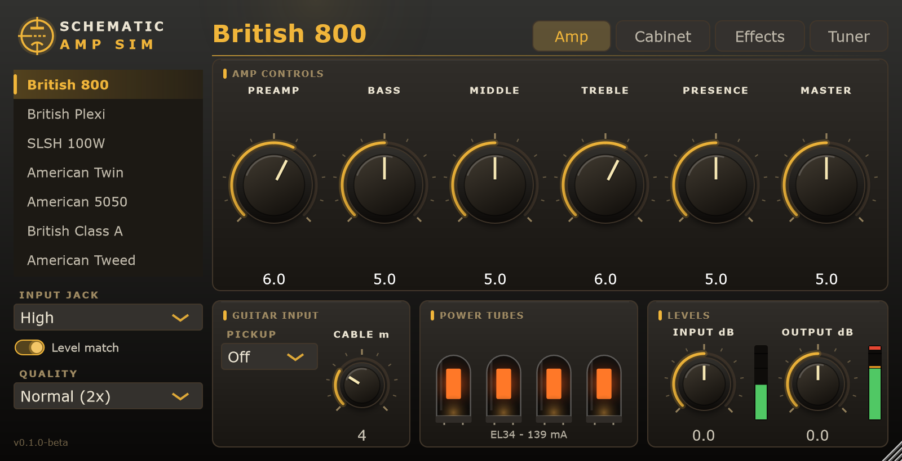
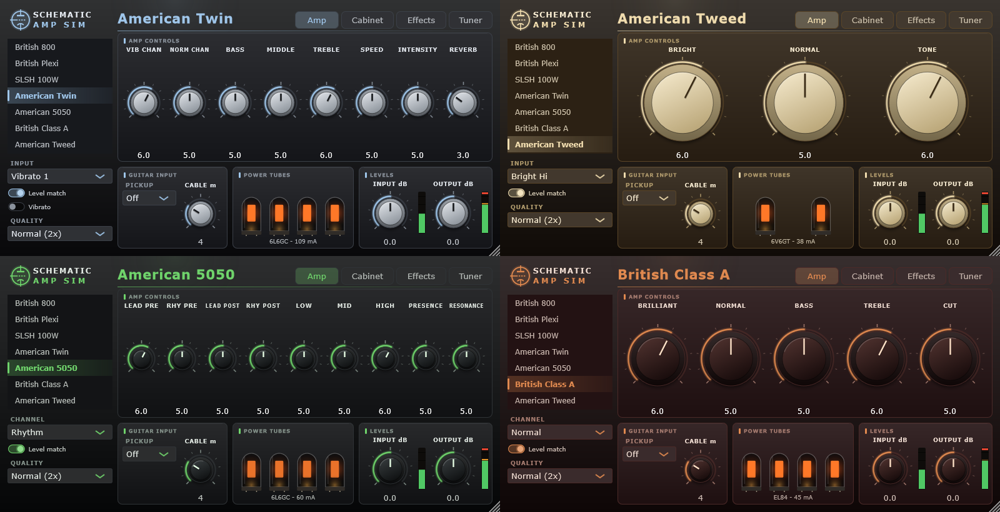
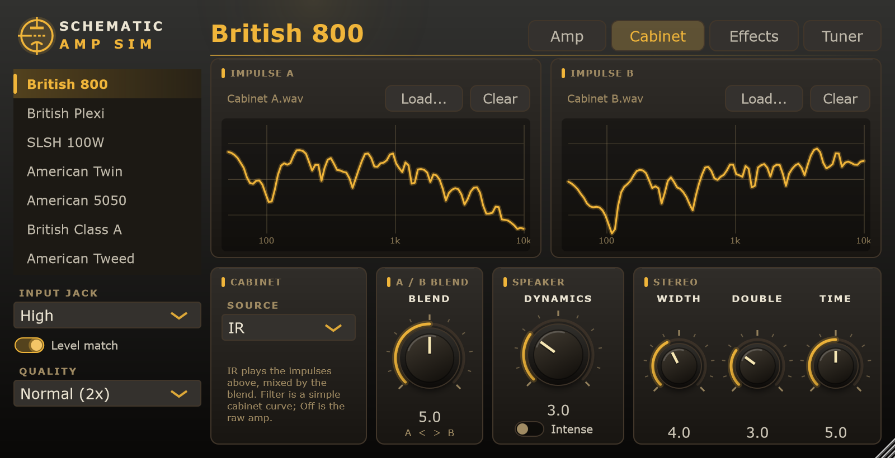
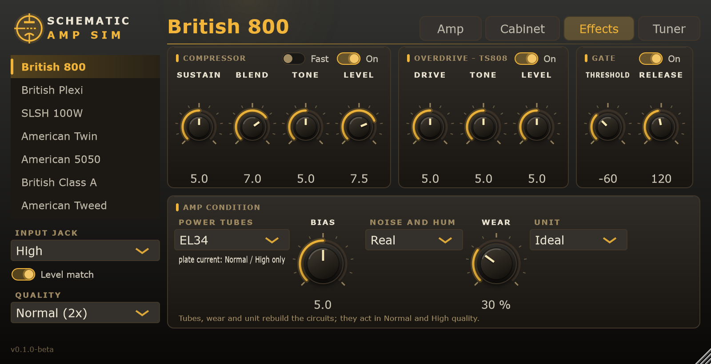
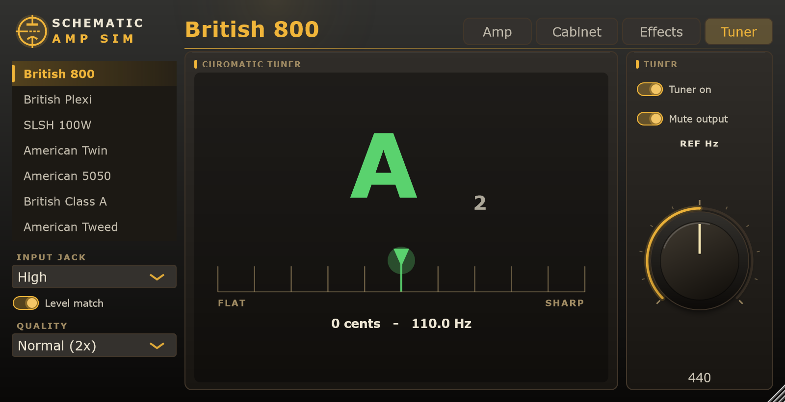

# Schematic Amp Sim

A guitar amp simulator that solves the real circuit instead of imitating it. Each amp is
transcribed from its schematic into a text netlist, and the plugin runs a nonlinear circuit solver
on it in real time: preamp stages, tone stack, phase inverter, output tubes and transformer included.

VST3 for Windows, built with C++20 and [JUCE](https://juce.com).

<p align="center">
  
</p>

## Screenshots

Every amp has its own colours (the amp list is on the left). Four of the eleven:

<p align="center">
  
</p>

The **Cabinet** page: two impulse responses with their response curves, the A / B blend, the speaker
dynamics and the stereo controls. The **Effects** page: compressor, overdrive, noise gate and the state of
the amp itself (tubes, bias, noise, wear, unit). The **Tuner**:

<p align="center">
  <br>
  <br>
  
</p>

(The pictures are rendered by the editor itself: see "Repository layout" for how to regenerate them.)

## Download

Get the latest version from the [Releases page](https://github.com/nicolasquijano/SchematicAmpSim/releases) (Windows 10/11, 64-bit, any VST3 host):

- **`SchematicAmpSim-<version>-win64-setup.exe`**: the installer. It puts the plugin in `C:\Program Files\Common Files\VST3`.
- **`SchematicAmpSim-<version>-win64.zip`**: the plugin bundle on its own, to copy into your VST3 folder by hand.

Then rescan the plugins in your DAW. The current version is a **beta** (see the [changelog](CHANGELOG.md)): the saved-project format may
still change between 0.x versions. Versioning and the steps of a release are in [docs/RELEASING.md](docs/RELEASING.md).

## Features

- **Circuit-level modelling.** Modified nodal analysis with a DK-style discretisation (trapezoidal
  capacitors, coupled inductors), Newton iteration with line search and a bounded continuation
  fallback. Devices: Koren triodes and pentodes (12AX7-type, EL34, EL84, 6V6, 6L6, 6550), diodes, BJTs, op-amps.
- **Amps are data, not code.** Each amp is a folder with a netlist and an `amp.json` that maps
  knobs, input jacks, presence, supply and output level onto circuit elements. Adding an amp means
  adding files; nothing is recompiled except to embed them.
- **Eleven amps included** (display names are deliberately generic):
  | Name | Circuit |
  |---|---|
  | British 800 | Cascading-gain preamp, 100 W-class EL34 power amp, High and Low input jacks |
  | British Plexi | Vintage 100 W-class EL34 head, two channels with jumper |
  | SLSH 100W | Modern 100 W head, 6550 output stage, two modes |
  | American Twin | Two-channel 85 W+ blackface-style amp, 12AT7 phase inverter, four 6L6GC on fixed bias with its optical vibrato and spring reverb (driver and recovery tubes as circuit, the spring tank behavioural) |
  | American 5050 | Modern high-gain 120 W head: two channels (Rhythm with a Crunch voicing, Lead) through six gain stages, Marshall-type tone stack, 12AX7 phase inverter with presence and resonance in the feedback loop, four 6L6GC |
  | American Triple Stack | Three-channel modern high-gain 100 W+ head: a clean channel with a Pushed voicing and two high-gain channels each with Raw, Vintage and Modern voicings, three tone stacks, a shared 12AX7 gain chain with a cathode follower, four 6L6GC, silicon rectifier. Presence in the feedback loop; the effects loop and the channel switching are not modelled |
  | American Bass 50 | 1959-style 50 W tweed bass head: bright and normal channels with #1 and #2 inputs (jumpered or not), 12AY7 / 12AX7 preamp with cathode follower, the 250p / 56k tone stack, long-tailed phase inverter with 27k negative feedback and presence, two 6L6GC with fixed bias, GZ34 rectifier and choke |
  | British Hi-Fi | High-headroom 100 W head with huge transformers: brilliant and normal channels (a 1000p or a 22n coupling) mixed into a double triode, the passive 1000p / 220p treble, middle and bass stack, master volume, long-tailed 12AX7 phase inverter with the feedback injected into its tail and a presence network, four EL34 on fixed bias, silicon bridge supply with three filtered HT stages |
  | British Or | Early-70s 120 W head: one input into two identical 12AX7 stages around the Orange tone circuit (1n5 / 10n treble, 1M bass, two 100k) and a gain pot, a six-position FAC switch (a ladder of 4n7 to 330p that cuts more bass at each step, selected with the channel list), a cathodyne inverter, four EL34 with a choke-fed screen supply and 15k negative feedback into the first triode's cathode with a BOOST control (2 mH / 0.47u). No master volume |
  | British Class A | Class A 30 W combo-style amp (Top Boost reissue drawing): Normal channel straight to the phase inverter, Brilliant channel through the Treble / Bass network, Cut control, four cathode-biased EL84 with no negative feedback (no vibrato or reverb) |
  | American Tweed | 1950s-style 12 W tweed combo: two channels with interactive volume pots and a tone control, 12AY7 / 12AX7 preamp, cathodyne phase inverter, two cathode-biased 6V6GT, no negative feedback, high-impedance 5Y3GT rectifier supply |
- **The loudspeaker is part of the circuit**: the output transformer drives a voice-coil resistance and inductance and the cone's mechanical resonance (typical 12 inch values scaled to each amp's load), so the amp's output voltage has the bass bump, the mid dip and the rising top of a tube amp into a real speaker. It can be turned off per amp with `"speaker_load": {"enabled": false}` in its `amp.json`. The output transformer also has winding capacitance and core loss (`transformer_parasitics`). The Lite mode does not reproduce the bump, the dip or the treble resonance.
- **Pitch shift** (Pitch tab): -12 to +12 semitones and fine tuning in cents, for dropped tunings, octaves or tuning the recording. A granular two-head shifter that works on chords; it adds about 12 ms of delay only while a shift is set.
- **Post equaliser** (EQ tab): five bands (low shelf, three bells, high shelf), a high-pass and a low-pass, with a draggable response curve; it works on the final stereo signal, after the cabinet, so it shapes the result without changing how the amp distorts. Next to the curve, a bass and treble harmonic exciter (maximizer) adds harmonics of each end.
- **Quality modes**
  | Mode | What it does |
  |---|---|
  | Normal | Full circuit, 2x oversampling |
  | High | Full circuit, 4x oversampling |
  | Lite | Full preamp circuit, behavioural power amp fitted against the full circuit |
  | Eco | Lite plus tabulated tube curves and a lighter solver; the multi-stage preamp is split in parts |
- **Amp condition** (Effects page): output-tube type (EL34 / 6L6GC / 6550 on the amps with a fixed bias,
  re-biased to the same share of the tube's dissipation rating), a bias control with the plate current in mA
  read from the circuit, noise and hum (hiss at the input, mains hum that depends on the pickup), wear
  (emission loss of the tubes, capacitance loss of the electrolytics and the reservoir) and a "unit" number
  that draws component tolerances. Tubes, wear and unit rebuild the circuits, so they act in the Normal and
  High modes only; the Lite fit belongs to the stock amp. The hiss and hum levels, the wear laws and the
  tolerances are typical figures, not measurements of a particular amp (see `engine/include/sas/noise.h` and
  `engine/src/condition.cpp`). `tools/sas_bias_cal` computes the `bias_scale` of each alternative tube.
- **Cabinet page:** off, a simple filter, or two impulse responses (A and B, each with its response curve) mixed with an equal-power blend; both are stored inside the project. Speaker dynamics sit between the amp and the cabinet: cone excursion (the motor force falls and the suspension stiffens as the cone is pushed), voice-coil heating and cone break-up, with an Intense mode. The values are typical figures, tuned by ear. **Stereo** (the amp is mono inside): the Width knob puts impulse A in the left ear and B in the right one (two microphones, one on each side; 0 blends both into both ears), and Double adds automatic double tracking, a second take with a different, slowly modulated delay in each ear (8 to 30 ms), which also works with the cabinet filter or a single impulse. Both are off by default, which leaves the same signal in both ears. A mono track can feed the stereo output.
- **Tube-screamer style pedal** in front of the amp (drive, tone, level).
- **Compressor pedal** (Effects page, in front of everything else), solved as a circuit from a transcription of the Keeley Compressor Plus schematic (AionFX trace v1.0, `engine/data/compressor.net`): an LM13700 OTA gain cell, a transistor full-wave envelope detector and the feedback that closes the loop, with Sustain, Blend, Tone, Level and the Attack switch (which in the circuit selects fast or slow release). It needed two new devices in the engine: an Ebers-Moll NPN that saturates and the OTA. It costs about 9 % of a core while on. The transistor, OTA and diode values are typical figures; the drawing prints none.
- **Chromatic tuner** (Tuner page): McLeod pitch detection on the raw input (60 Hz to 1.4 kHz, within a cent on clean notes, without octave errors on a weak fundamental), a needle meter, a reference pitch of 430 to 450 Hz and an option to mute the output while tuning.
- **Level matching** across amps, jacks and modes, so switching does not jump in volume.
- Fast parameter smoothing, no allocations on the audio thread; switching amps builds the new
  circuits on a worker thread and swaps them in without stopping audio.

## Parameters

Amp, Volume, Volume 2, Bass, Middle, Treble, Presence, Master, Power, Input, Output, Quality,
Cab (Off / Filter / IR), Jack (1-4), Level match, Vibrato (On, Speed, Intensity) and Reverb and Resonance (amps that have them), the pedal controls (On, Drive, Tone, Level), the noise gate, the guitar input (pickup, cable) and the amp condition (Power tubes, Bias, Noise and hum, Wear, Unit).
Which knobs apply depends on the selected amp. The editor has four pages: Amp, Cabinet, Effects and Tuner.

## Building

Requirements: Windows 10/11, Visual Studio 2022 Build Tools (MSVC), Git. CMake and Ninja are
taken from the Build Tools. Dependencies (JUCE 8.0.16, Catch2 3.16.1, nlohmann/json 3.11.3) are
fetched by CMake into `third_party/` on first configure.

```bat
build.cmd              :: configure and build everything
build.cmd test         :: ... and run the tests
build.cmd target sas_tests
```

The plugin ends up in `build/plugin/SchematicAmpSim_artefacts/Release/VST3/`. To install, copy the
`Schematic Amp Sim.vst3` bundle contents to
`%LOCALAPPDATA%\Programs\Common\VST3\Schematic Amp Sim.vst3` (or `C:\Program Files\Common Files\VST3`)
with the DAW closed, then rescan plugins.

## Repository layout

```
engine/    solver library, no JUCE dependency (linear algebra, devices, circuit, netlist, oversampling, chain)
amps/      one folder per amp: amp.json + .net files, embedded into the build
plugin/    JUCE processor, editor, parameters, cabinet convolution
tests/     Catch2 unit tests and parity tests against reference data (100+ tests)
docs/      screenshots for this README (docs/images)
tools/     sas_bench, sas_inspect, sas_fit_lite, sas_match_levels
golden/    reference output from the original Rust implementation
```

## Adding an amp

1. Create `amps/<id>/` with `preamp.net`, `poweramp.net` and `amp.json`.
2. Write the netlist (R, C, T triode, P pentode, D, Q, O op-amp, V/I sources, `.param`, `.xfmr`).
   Values accept SI suffixes and RKM notation (`4k7`, `2n2`).
3. In `amp.json`, map the knobs (pot type, taper, total resistance), jacks, presence and supply.
4. Run `sas_inspect <id>` to check DC operating points, then `sas_fit_lite <id>` to fit the Lite power
   amp and `sas_match_levels` to set the output trim.
5. Rebuild: amps are discovered by globbing `amps/*/amp.json` and embedded automatically.

## Regenerating the screenshots

The pictures in `docs/images` are rendered by the editor itself, headless, in the states shown above:

```bat
set SAS_SCREENSHOT_DIR=docs\images
build\tests\sas_plugin_tests.exe "readme screenshots"
```

## Status

Windows VST3 is released. macOS (VST3 and Audio Unit, one binary for Apple Silicon and Intel) is built and tested by GitHub Actions on every push, but has not been tried on a real Mac yet and is not notarized. Planned: AAX. The Eco mode and the level
matching have been verified with tests, not yet extensively by ear.

## License and trademarks

All product names, trademarks and brands belong to their respective owners. This project is not
affiliated with or endorsed by any amplifier manufacturer; the circuits are independent
transcriptions made for educational and research purposes, and the amp names are generic.

Free software, licensed under the [GNU Affero General Public License v3.0](LICENSE). Contributions
are welcome under the same license. The plugin is built on JUCE (used under AGPLv3), Catch2 (BSL-1.0)
and nlohmann/json (MIT).
